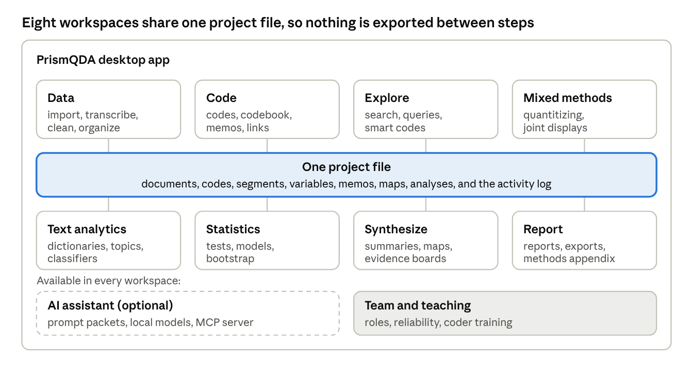
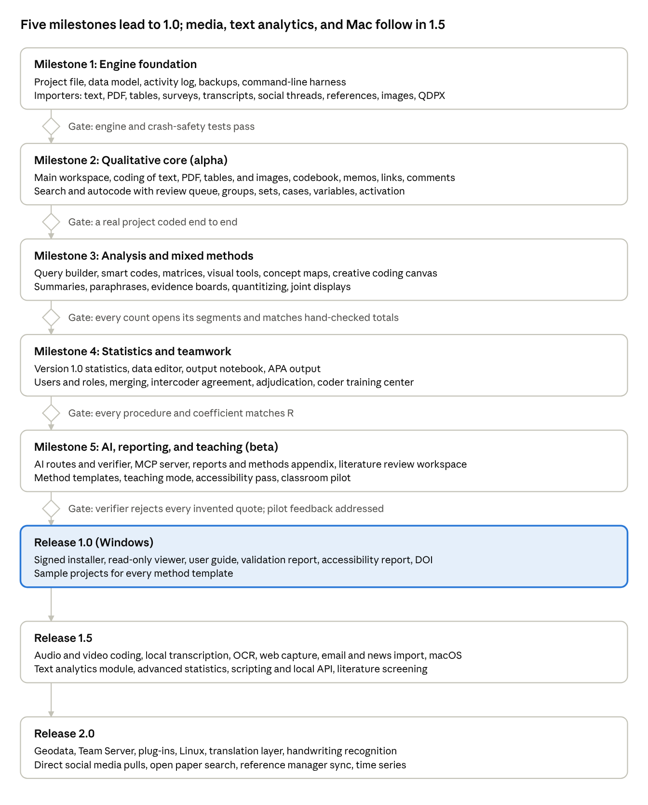

# PrismQDA Specification

> The governing specification, adopted 2026-11-05 (decision 43 in [DECISIONS.md](DECISIONS.md)). [ROADMAP.md](ROADMAP.md) says what is built and in what order, and [INTERFACE.md](INTERFACE.md) is the interface design.

PrismQDA is a free, local-first desktop platform that puts qualitative coding, quantitative content analysis, statistics, and mixed-methods integration in one project, so a researcher can move from raw data to a documented, publishable analysis without switching programs.

## 1. Vision, users, and design principles

PrismQDA aims to be the one tool a researcher needs from the first transcript to the final table: every data type, every common qualitative method, word-level content analysis, a full statistics package, and mixed-methods displays that tie the numbers back to the quotes, free and on the researcher's own computer.

### 1.1 Who it serves

| User | What they need most |
| --- | --- |
| Undergraduate and graduate students | A tool they can keep after the course ends, guidance through a method, and help writing up |
| Faculty and independent researchers | Depth: complex queries, every data type, reliability, statistics, publication-ready output |
| Research teams | Shared codebooks, coder roles, merging, reliability checks, and coder training |
| Methods instructors | Assignments, reference coding, comparison of student work, and feedback |
| Evaluators, nonprofits, and government analysts | Surveys and open-ended responses at scale, dashboards for stakeholders, data that never leaves the building |
| Applied and market researchers | Fast coding of large comment sets, sentiment, text mining, and charts for reports |

### 1.2 Design principles

1. One project, three lenses. Every piece of data can be read qualitatively, counted quantitatively, and tested statistically without exporting it anywhere.
2. Everything clicks back to the data. Every count, cell, chart point, and statistic opens the segments behind it.
3. The researcher decides. Automation and AI propose; people accept, edit, or reject; every action is logged.
4. Method-aware, never method-bound. Templates guide named methods, and free mode allows anything.
5. Local first and free. No subscription, no account, no server required, and an open project format.
6. Familiar on first launch. The interface follows the layout conventions researchers already know from the field (see [INTERFACE.md](INTERFACE.md)).
7. Correct before clever. Every statistic is validated against R; every AI quote is checked against the source.
8. Accessible to everyone. Keyboard-complete, screen-reader labeled, and accessible exports.

### 1.3 What "complete" means

PrismQDA 1.0 must cover every function in sections 5 through 27 marked 1.0 in the roadmap (section 29), except where the confirmed 1.0 cut in [ROADMAP.md](ROADMAP.md) section 2 moves a function to 1.5; the cut governs. Later versions add the rest. Nothing in this specification depends on a paid service.

## 2. Product shape

PrismQDA is one application with eight workspaces that read and write the same project, plus an AI layer and team features available everywhere.

Workspaces are tabs in the main window, not separate programs, and any view can be opened beside any other. A researcher can code an interview, see a code matrix update, run a chi-square on it, and drop the table into a report without leaving the window.

## 3. Platform, architecture, and license

PrismQDA is a native desktop application with a headless Rust engine, a TypeScript interface in a Tauri shell, and an Apache 2.0 license.

### 3.1 Platforms

| Platform | Version |
| --- | --- |
| Windows 10 and 11, 64-bit | 1.0 |
| macOS 13 and later, Apple silicon and Intel | 1.5 |
| Linux (AppImage, Debian package) | 2.0 |
| Portable mode (runs from a USB drive, settings stored beside the program) | 1.0 |
| Read-only Viewer (free, opens any project for review without editing) | 1.0 |

Projects open identically on every platform, and every feature works the same on each.

### 3.2 Architecture

- Engine: a Rust library holding the project store, importers, coding, search, queries, reliability, text analytics, statistics, AI connectors, and exporters. It has a command-line harness and is fully tested on its own.
- Interface: TypeScript, with dockable panes and tabbed windows, calling the engine through Tauri commands.
- Background workers: transcription, OCR, AI batches, topic models, bootstraps, and large imports run in separate worker processes with progress, pause, and cancel.
- Local services: an MCP server and a local automation API, both off by default (section 25).
- Optional add-on: PrismQDA Team Server, a self-hosted sync service an institution can run on its own hardware (section 18.6). The desktop app never requires it.

### 3.3 License and clean-room rules

- All PrismQDA code: Apache 2.0, with a NOTICE file. Dependencies must use permissive licenses (Apache 2.0, MIT, BSD, ISC, Zlib); GPL, AGPL, and non-commercial licenses are blocked by the build's license checker.
- PrismQDA is designed from this specification, published standards (REFI-QDA), published statistical definitions, and methods literature. No other QDA program's source code is read or reused, and no other program's interface wording, icons, schema, or help text is copied.
- Dated design records are kept as evidence of independent design.

### 3.4 Distribution

- Signed installer and signed automatic updates (with permission), plus an offline installer for locked-down campus labs.
- Silent install options and a settings file for IT departments deploying to labs.
- Each release has a DOI and a citation in APA style built into the Help menu and every report.

## 4. Projects and data model

A project is one documented SQLite file holding every document, code, segment, memo, variable, map, query, dictionary, analysis, and log entry, with large media either embedded or linked from a folder beside it.

### 4.1 Project files

- One file per project (extension `.pqda`, provisional until the file format is final). Transactional writes, so a crash never corrupts it.
- Media: embed small files; link large audio and video from a media folder, with a "bundle" command that zips project and media for transfer.
- Automatic backups when a project opens and at a set interval, plus named snapshots ("before merging Coder B").
- Project templates: start from a saved structure (codebook, variables, document groups, method template) with no data.
- Password protection and encryption at rest (section 27).
- Published schema, so R, Python, or any SQLite tool can read a project.
- Archive for reuse: export documents, codebook, memos, and variables to a plain folder structure for data repositories.

### 4.2 Core entities

| Entity | Purpose | Notable fields |
| --- | --- | --- |
| Document | One analyzable item: text, PDF, table, image, audio, video, web page, email, survey, social media set, geo document | Type, group, color, author, import source, text revision, page or time map |
| Document group | Folder that holds documents | Name, color, nesting |
| Document set | Saved selection of documents from any groups | Name, rule (static or smart) |
| Case | The unit compared in analysis: a person, site, video, or thread | Linked documents or segments |
| Variable | Attribute of a document, case, code, speaker, or segment | Type (text, integer, decimal, date, boolean, category), level of measurement, value labels, missing values, static or dynamic over time |
| Code | Category in the code system | Name, parent, color, type (code, theme, category, smart code, snapshot code), definition, inclusion and exclusion rules, anchor examples, alias, author |
| Code set | Saved group of codes across the tree | Name, rule (static or smart) |
| Segment | One coding of one region | Document, region (text span, PDF region, image area, time span, table cell, geo point), code, coder, weight, rating, comment, name, origin (human or AI), timestamps |
| Memo | Written analysis | Type and icon, title, rich text, attachments to any entity, links into data, author |
| Link | Connection between entities | Internal (segment to segment), external file, web address, geo location, relation type |
| Relation | Named link type for maps | Name, direction, symmetry, line style |
| Map | Concept map or network | Nodes, links, layers, layout, synced or free |
| Paraphrase and summary | Researcher's own wording of segments, documents, or code-by-case cells | Author, target, text |
| Query | Saved retrieval or analysis | Definition, scope, results snapshot |
| Dictionary | Content analysis categories | Categories, words, phrases, rules, weights |
| Analysis run | Any table, chart, or statistic | Inputs, options, outputs, rerun history |
| Event | One logged action | Actor, time, action, before and after |
| AI run | One AI request | Model, prompt, data sent, answer, decisions |

### 4.3 Supported scale

At least 10,000 documents, 100 million words, 5,000 codes, 2 million segments, 1,000 variables, and 50 GB of linked media per project, with the interface staying responsive (section 28).

## 5. Data sources and import

PrismQDA imports every kind of material a qualitative or mixed-methods study collects, keeps its structure (speakers, pages, timestamps, survey columns, reply threads), and turns metadata into variables automatically.

| Data type | Formats and sources | What the importer keeps or creates | Version |
| --- | --- | --- | --- |
| Text documents | DOCX, DOC, ODT, RTF, TXT, Markdown, HTML, EPUB | Formatting, headings, tables, embedded images, Word comments as memos | 1.0 |
| PDF | Text PDFs in original layout; scanned PDFs through OCR | Pages, bookmarks, annotations and highlights as memos or codings | 1.0 |
| Transcripts | TXT, DOCX, RTF, SRT, VTT, and common transcription-service exports | Speaker turns, timestamps linked to media | 1.0 |
| Focus groups | Multi-speaker transcripts | One unit per contribution, speaker variables, per-speaker analysis | 1.0 |
| Spreadsheets and tables | XLSX, CSV, TSV, ODS | Table documents with cell-level coding; columns become variables | 1.0 |
| Survey data | Excel, CSV, SPSS .sav, Stata .dta, and direct pulls from common survey platforms | Open-ended answers as codable units, closed answers as variables, automatic question codes | 1.0 |
| Images | PNG, JPG, GIF, TIFF, HEIC, WebP | Region coding, EXIF data (date, location) as variables | 1.0 |
| Audio | MP3, WAV, M4A, AAC, FLAC, OGG, WMA | Waveform, time-span coding, transcription | 1.5 |
| Video | MP4, MOV, AVI, MKV, WebM, M4V | Time-span coding, frame snapshots, transcription | 1.5 |
| Web pages | Saved pages, URLs, and a browser capture extension | Text, images, or PDF snapshot; URL and capture date as variables | 1.5 |
| Social media | Exports and API pulls from YouTube, Reddit, X, Facebook, Instagram, TikTok, Mastodon, Bluesky; comment threads | Posts and comments as units with parent, author, role, date, likes, reply count | 1.0 (files), 2.0 (direct pulls) |
| Email | EML, MSG, MBOX, Outlook and Gmail exports | Headers as variables, attachments as documents, threads kept | 1.5 |
| News databases | Exports from common news archives | Headline, source, date, section as variables | 1.5 |
| Reference managers | RIS, BibTeX, EndNote XML, and CSL JSON libraries from reference managers | PDFs with citation fields as variables, abstracts and notes | 1.0 |
| Geodata | KML, KMZ, GPX, GeoJSON, place lists | Geo documents with codable points and areas | 2.0 |
| Structured text | Preprocessed files with document separators and code tags | Automatic split into documents and automatic coding | 1.0 |
| Other QDA projects | REFI-QDA project (QDPX) and codebook (QDC) | Documents, codes, segments, memos, cases, variables, links | 1.0 |
| Statistical data | SPSS .sav, Stata .dta, SAS transport, R .rds, Excel | Variables with labels and missing values for the statistics module | 1.0 |
| Notes apps | Exports from common note-taking apps | Notes as documents, tags as codes | 2.0 |

### 5.1 Import behavior

- Drag and drop files or whole folders onto the document pane; a wizard opens only when choices are needed.
- Watched folders: new files in a chosen folder are imported automatically on open.
- Document conversion wizard for splitting one file into many cases by heading, separator, page, or row.
- Duplicate detection by content hash.
- Every import produces a report of warnings, and the original file hash is stored.

## 6. Preparing data

Before and during coding, researchers can edit, transcribe, clean, translate, and de-identify their data inside PrismQDA, and every change keeps existing codings in place.

### 6.1 Editing

- Rich-text editor for text and table documents, with tracked revisions and offset remapping so codings survive edits.
- Create new documents and tables inside the project (field notes, observation logs, interview notes).
- Line numbers or paragraph numbers, switchable, for citing quotes.
- Spell check, find and replace across documents, and a semi-automatic correction pass for misspellings and unknown words.
- Document color labels and document properties (author, date, source, notes).

### 6.2 Transcription

| Feature | Detail | Version |
| --- | --- | --- |
| Local automatic transcription | Runs offline on the user's computer, CPU or GPU, queued in the background, no hour packs | 1.5 |
| Speaker diarization | Detects speakers and labels turns for review | 1.5 |
| Manual transcription | Media player docked beside the editor; play, pause, rewind interval, speed 0.5x to 2x, volume | 1.5 |
| Foot pedal support | Common USB transcription pedals mapped to play, pause, rewind | 1.5 |
| Text snippets | Abbreviations that expand while typing (speaker names, common phrases) | 1.5 |
| Timestamps | Inserted automatically or by key; linked to the media position | 1.5 |
| Synchronized playback | Transcript scrolls with playback; clicking a timestamp jumps the media | 1.5 |
| Import existing transcripts | Timestamp formats from common services recognized and linked | 1.5 |
| Transcription conventions | Verbatim layer and readable layer, filler-word cleanup on the readable layer only | 2.0 |

### 6.3 Cleaning and structure

- Speaker detection: recognize speaker labels in any transcript, group spelling variants, and autocode each speaker's turns.
- Segmentation: split documents into units (sentence, paragraph, turn, response, post) for unit-based coding and reliability.
- Language detection per document or unit, for filtering multilingual projects.
- OCR for scanned PDFs and images, with confidence flags on weak pages (1.5).
- Handwriting recognition for scanned field notes, with review before acceptance (2.0).

### 6.4 De-identification

- Pseudonymization: find names, places, organizations, and other identifiers; replace them consistently across all documents; keep the mapping table in a separate protected file.
- Redaction: black out passages in exports, non-destructively in the project.
- Re-identification check: flag rare combinations of details that could identify someone (2.0).
- Anonymized export: a copy of the project with chosen codes or variables replaced or removed.

### 6.5 Translation layer (2.0)

A parallel translated text kept aligned with the original, so researchers can code in either language and see both side by side.

## 7. Organizing data

Researchers organize material in three ways that work together: where documents live (groups), which documents belong together for a question (sets), and what each document, case, or speaker is (variables).

### 7.1 Groups, sets, and folders

- Document groups: nested folders with colors, drag-and-drop ordering, and a user-defined sort order.
- Document sets: saved selections across groups. Static sets hold chosen documents; smart sets update from a rule such as "interviews from site B with age over 40."
- Code sets and memo groups work the same way for codes and memos.
- Any group or set can act as a filter on every analysis view (section 13.4).

### 7.2 Cases

- A case is the unit of comparison. Create cases from documents (one per document), from speakers (one per focus-group participant), from spreadsheet rows, from thread containers, or by hand.
- One document can hold several cases, and one case can span several documents (repeat interviews).
- Case classifications define what kind of thing a case is (participant, organization, site) and which variables it carries.

### 7.3 Variables

| Feature | Detail |
| --- | --- |
| Levels | Document, case, speaker, code, and segment variables |
| Types | Text, integer, decimal, date and time, yes or no, category with value labels |
| Level of measurement | Nominal, ordinal, interval, ratio (drives valid statistics) |
| Missing values | Up to three missing-value codes per variable |
| Data editor | Spreadsheet view with sort, filter, paste from Excel, fill down, recode |
| Import and export | Excel, CSV, SPSS .sav, Stata .dta |
| Computed variables | Formulas over other variables, recodes, binning, date parts, code counts and code presence (quantitizing) |
| Dynamic variables | Values that change across time points for the same case (wave 1, wave 2), for longitudinal studies |
| Classification sheets | One table per case type, for entering and reviewing attributes |
| Variable charts | Frequency tables, bar and pie charts for any variable, each clickable to its documents |

### 7.4 Activation and focus

Any combination of documents, codes, and variables can be activated with a click or a rule, and every retrieval, table, and chart then works only on what is active. A status bar always shows what is active, and one click clears it.

## 8. Coding

Coding in PrismQDA is fast, flexible, and the same on every data type: select a region, apply one or more codes by drag, click, key, or typing, and see the result at once in the margin.

### 8.1 Ways to code

| Method | How it works |
| --- | --- |
| Drag and drop | Drag selected text onto a code, or a code onto selected text |
| Coding palette | Type-ahead box at the selection; Enter applies, Shift+Enter creates a new code |
| In-vivo coding | Creates a code named from the selected words and applies it |
| Open coding mode | Every selection opens a quick name box, for fast first-pass coding |
| Quick coding | Repeat the last code, or the last set of codes, with one key |
| Favorite codes | Keys 1 to 9 apply pinned codes; favorites bar above the document |
| Highlighter pens | Colored marker codes for a first read, convertible to real codes later |
| Symbol coding | Emoji or symbol codes for tone, emphasis, or nonverbal cues |
| Unit coding | Code a whole sentence, paragraph, turn, or response with one key, then jump to the next uncoded unit |
| Grid coding | Table of short responses or posts with code columns and checkboxes, for surveys and comments |
| Structure autocoding | Code by heading level, paragraph style, speaker, or question label in one step |
| Code from search | Apply a code to search hits at the word, sentence, paragraph, or unit (section 12) |
| Code in maps and memos | Memos and map notes can be coded like documents |

### 8.2 What can be coded

- Text spans of any length, overlapping and nested.
- PDF text in original layout, and rectangular PDF regions for figures and tables.
- Image regions: rectangles, ellipses, and freehand polygons.
- Audio and video time spans on a waveform or timeline, with optional coding of the matching transcript text.
- Table cells, rows, or columns.
- Geo points and areas (2.0).

### 8.3 Segment details

- Weight from 0 to 100 per segment, for intensity or importance.
- Rating scales defined per code (for example 1 to 5 for strength of trust), with labels for each point.
- Comment, name, and coder on every segment; origin flag (human or AI).
- Resize a segment by dragging its edges; split or merge adjacent segments.
- Replace a code by dropping another code on its margin stripe.
- Mutually exclusive groups: codes in a group cannot overlap on the same unit, with a warning or block, chosen per group.

### 8.4 Seeing your coding

- Coding stripes in the margin, one column per code, with code color and name; stripes can be filtered by code, code set, coder, or origin.
- Inline highlighting in code colors, with adjustable opacity.
- Coder icons in the margin for team projects.
- Hover any stripe to see the code, weight, comment, and coder; click it to select the segment.
- Coding density bar on the scroll track, showing where in a long document coding sits.

### 8.5 Working with coded segments

- Segment review table: every segment of selected codes with context, sortable and editable (change code, weight, comment, boundaries) without opening documents.
- Move or copy all segments from one code to another.
- Find and clean redundant codings (the same code applied twice to overlapping text).
- Undo and redo for every coding action, unlimited within a session.

## 9. Codebook management

The code system is both a working tool and a publishable codebook: every code carries its definition, rules, examples, and history, and the structure can be reshaped at any time without losing work.

### 9.1 Code system

- Hierarchy of any depth, displayed as a tree with counts (segments, documents, cases) beside each code.
- Drag to reorder and reparent; sort alphabetically or by frequency; collapse and expand all.
- Code types: ordinary codes, theme or category codes that group others, smart codes built from queries (section 13), and snapshot codes that freeze a query result.
- Aggregation: a parent can show its own segments alone or with all its children.
- Code colors from a palette or any custom color; color applies to stripes, highlights, maps, and charts.
- Code sets (static or rule-based) for working with codes from different branches together.
- Code variables, so codes themselves can carry attributes (for example, "deductive" or "inductive").
- Groundedness and density shown for each code: how many segments it has and how many links it has to other codes.

### 9.2 Code properties

| Property | Use |
| --- | --- |
| Name and alias | Short label plus an optional longer name for reports |
| Definition | What the code means |
| Inclusion and exclusion criteria | When to apply and when not to |
| Anchor examples | Typical segments, picked by right-clicking any segment |
| Counter-examples | Segments that look similar but do not fit |
| Rating scale | Optional scale for segment ratings (section 8.3) |
| Author and dates | Who created it and when |
| Code memo | Longer analytic writing about the code |

### 9.3 Reshaping

- Merge codes, with the mapping kept in the log.
- Split a code into subcodes by reassigning its segments in a sorting view.
- Duplicate, move, or delete codes, with a confirmation that shows how many segments are affected.
- Creative coding canvas: drag codes onto a free board, group and link them visually, and write the new structure back to the code system (section 15.4).
- Codebook versions: freeze a numbered snapshot with a note, compare any two versions, and restore one.

### 9.4 Import and export

- Import a codebook from Excel, Word outline, REFI-QDA codebook (QDC), or another PrismQDA project.
- Export the codebook to Word or PDF (formatted with definitions and examples), Excel, and QDC.
- Transfer the code system, or parts of it, between projects.

## 10. Memos, comments, links, and the logbook

PrismQDA gives analytic writing equal standing with coding: memos attach anywhere, link into the data, can themselves be coded, and become documents or report sections when the thinking matures.

### 10.1 Memos

| Feature | Detail |
| --- | --- |
| Where memos attach | Project, document, document group, case, code, segment, map, query result, or free-standing |
| Memo types | Analytic, theoretical, method, reflexive, to-do, question, and user-defined types, each with its own icon and color |
| Display | Memo icons in the document margin and beside codes and documents; hover to preview |
| Editor | Rich text, images, tables, and citations; several memos open at once in tabs |
| Memo manager | Table of all memos with type, author, date, links, and full-text search; filter and sort |
| Linking | Link memo passages to segments, codes, or other memos; links open in both directions |
| Coding memos | Memos can be coded like documents |
| Convert | Turn a memo into a document for analysis, or into a report section |
| Memo groups | Organize memos into folders and smart groups |

### 10.2 Comments

- Short notes on any segment, document, code, variable value, or map element, separate from memos.
- Comment threads for team discussion, with mentions of coders and a resolved state.

### 10.3 Links

- Internal links between any two segments (for example, a claim and its contradiction), with a named relation.
- External links to files on the computer and web addresses.
- Geo links from a segment to a map location.
- A link browser that lists all links, follows them, and draws them on a map.

### 10.4 Logbook and project journal

- A dated research journal for the project, separate from memos, opened with one key.
- Automatic entries for milestones (imports, codebook versions, reliability runs, merges), mixed with the researcher's own notes.
- Exports as a decision timeline for methods sections (section 23).

## 11. Summaries, paraphrases, and synthesis workspaces

Between coding and writing, researchers condense: they paraphrase passages, summarize what each case says about each theme, and gather evidence into arguments. PrismQDA gives each of those steps its own workspace, all linked to the source segments.

| Workspace | What the researcher does there | Output |
| --- | --- | --- |
| Paraphrase mode | Write a short paraphrase beside any passage, image region, or media clip; group paraphrases into categories that become codes | Paraphrase table and category list |
| Paraphrase matrix | See paraphrases side by side for several documents or cases | Matrix export to Word and Excel |
| Summary grid | A cases-by-codes grid; each cell shows that case's segments for that code, with a box to write a summary in the researcher's words | Summary per case and code |
| Framework matrix | The same grid organized by case classifications, for framework analysis | Matrix with summaries and linked quotes |
| Summary tables | Compile chosen summaries into tables for groups of cases (for example, by site) | Word and Excel tables with optional variables |
| Summary explorer | Compare summaries across cases or groups side by side | Comparison view |
| Case profiles | One page per case: variables, top codes, key quotes, summaries, memos | Profile document per case |
| Segment reader | Read all segments of a code or query in one scrolling view, with context on demand and notes in the margin | Notes and selected quotes |
| Evidence board | Gather quotes, summaries, charts, memos, and statistics under a research question, then arrange them into an argument outline | Worksheet exported to Word as a draft results section |
| Report manager | A project scrapbook of saved tables, charts, query results, and notes in a table of contents | Combined Word, PDF, or HTML report |

All of these work on whatever is activated or filtered (section 7.4), every item links back to its segments, and AI help (section 19) can draft summaries for review, clearly marked as AI drafts.

## 12. Search, retrieval, and computer-assisted coding

PrismQDA finds material by words, patterns, meaning, and similarity to what has already been coded, and every search result can be read in context, exported, or coded through a review queue.

### 12.1 Text search

- Search one document, the active documents, all documents, memos, or all of these.
- Exact words, phrases, wildcards, Boolean operators (AND, OR, NOT), proximity (NEAR, BEFORE, AFTER within n words), and regular expressions.
- Optional lemmatization ("feel" finds "felt" and "feeling"), synonym expansion from an editable thesaurus, and case or accent sensitivity.
- Saved search terms and search history.
- Results as a list with keyword in context, hit counts by document, and a highlight trail in each document.

### 12.2 Retrieval tools

| Tool | What it finds |
| --- | --- |
| Segment retrieval | All segments of the activated codes in the activated documents, with source and context |
| Section retrieval | Text between two markers or headings (for example, every answer to question 4) |
| Keyword retrieval | Passages matching words or dictionary categories, ranked by relevance |
| Query by example | Passages similar in meaning to a sample passage the researcher supplies |
| Similar-to-code search | Uncoded passages that resemble a code's existing segments, ranked by similarity |
| Cluster extraction | Groups of near-identical sentences that recur across documents (boilerplate, shared phrases, repeated stories) |
| Entities | People, organizations, places, dates, and other named entities, with counts |
| Dates and places | Passages mentioning dates or locations, for timelines and maps |
| Sentiment | Positive, negative, and neutral passages, with an adjustable threshold |
| Concepts | Frequently occurring noun phrases and concepts, as a starting list for codes |
| Random segments | A random sample of segments of a code, for checking consistency |
| Comment and link retrieval | All segment comments, or all linked segment pairs |

### 12.3 Autocoding

- Any search or retrieval result can be coded at the hit, the sentence, the paragraph, the unit, or a span of n words around it.
- Autocoding always passes through a review queue: each hit can be accepted, rejected, or adjusted, and decisions are logged.
- Speaker autocoding, structure autocoding (headings, styles, question labels), and dictionary autocoding (section 16) use the same queue.

## 13. Queries, smart codes, and smart groups

The query builder answers questions like "where do participants over 50 talk about cost near mentions of trust, but not in the interviewer's turns?" visually, without syntax, and saves the answer as something that updates itself as coding grows.

### 13.1 Query builder

| Operator family | Operators |
| --- | --- |
| Boolean | AND (all), OR (any), ONE OF (exactly one), NOT (none) |
| Position | Overlaps, overlapped by, within, encloses, follows, precedes, adjacent, near within n words, sentences, paragraphs, or units |
| Hierarchy | A code with all its subcodes, a code's parent, a code's siblings |
| Filters | Weight or rating range, coder, coder role, origin (human or AI), date coded, segment comment contains |
| Scope | Documents, groups, sets, cases, and variable conditions (for example, age over 50 and site equals B) |

- Queries are built by dragging codes into blocks, with a plain-language sentence under the builder that reads the query back ("Segments coded Cost near Trust within 2 paragraphs, in documents where Age &gt; 50").
- Results show segments in context, counts by document and case, and a chart.
- Results can become a new code, a smart code, a document set, a map, or a report item.
- Queries are saved, named, rerun on demand, and listed in a query library with their last result counts.

### 13.2 Smart and snapshot entities

- Smart code: a code defined by a query; it always shows the current matching segments and can be used in other queries and tables like any code.
- Snapshot code: a frozen copy of a query result at a point in time, for reporting.
- Smart document set and smart code set: sets defined by rules over variables or codes, updating automatically.
- Smart cases: cases grouped by a rule (for example, "participants who mention both Cost and Trust").

### 13.3 Matrix and comparison queries

| Query | Output |
| --- | --- |
| Codes by documents, cases, groups, or variable values | Counts, percentages, coverage, or the segments themselves in each cell |
| Code co-occurrence | Code by code counts with Jaccard, overlap coefficient, and co-occurrence coefficient, flagged when unequal frequencies distort the coefficient |
| Code patterns | Which combinations of codes appear together in a document or segment, and how often |
| Code sequence | Which code tends to follow which, within a set distance |
| Coding comparison | Two coders' or two groups' coding side by side for the same documents |
| Compound query | Text search and coding query combined |
| Group query | Which items are linked to or coded by which others |

Every cell opens its segments, every table exports to Excel and Word, and every table can be sent to the statistics module (section 17).

### 13.4 Global filters

A filter bar applies a document set, code set, or variable rule to every open view at once, with a visible badge so researchers always know when a filter is on.

## 14. Mixed methods and joint displays

Mixed methods is where PrismQDA earns its place: qualitative codes become variables, variables split qualitative findings into groups, and joint displays put both kinds of evidence on one page, every cell linked to its quotes or its numbers.

### 14.1 Moving between data types

| Direction | Tool |
| --- | --- |
| Qualitative to quantitative (quantitizing) | Turn code presence, counts, coverage, or weights into case or document variables; turn a set of codes into one categorical variable |
| Quantitative to qualitative (qualitizing) | Turn variable values into codes or document sets; build typologies from variable profiles |
| Text to numbers | Dictionary category counts and topic scores as variables (section 16) |
| Numbers back to text | Any statistical result opens the cases and segments behind it |

### 14.2 Joint displays

| Display | What it shows |
| --- | --- |
| Crosstab | Code frequencies or percentages by variable groups, with normalization for unequal group sizes |
| Segment matrix | The actual segments of chosen codes, by variable groups |
| Typology table | Means, standard deviations, and frequencies of variables for groups defined by codes |
| Qualitative themes by quantitative groups | Segments of a theme split by groups formed from variables |
| Statistics by qualitative groups | Variable statistics for groups formed by codes |
| Side-by-side display | Qualitative and quantitative results for the same topics in two columns |
| Code by variable bubble plot | Up to four dimensions at once: two variables on the axes, bubble size for code frequency, color for average weight |
| Descriptor by descriptor by code chart | Code application across two crossed variables |
| Deviation table | Codes most and least typical of each group compared with the others |
| Similarity analysis | Which documents or cases are most alike on codes and variables |
| Case-ordered display | Cases sorted by a variable, with their codes and quotes in rows |
| Triangulation matrix | Convergence, complementarity, or discordance between strands, marked by the researcher per topic |

### 14.3 Design templates

Templates for convergent, explanatory sequential, exploratory sequential, and embedded designs set up the right variables, document groups, and joint displays, and add matching sections to the methods report (section 23).

### 14.4 Longitudinal analysis

Dynamic variables (section 7.3) let the same case carry different values at each wave, and code trends show how themes change across waves, documents, or time within a document.

## 15. Visual tools

Every visual in PrismQDA is interactive: hovering shows the numbers, clicking opens the segments behind any mark, and every visual exports as PNG, SVG, or PDF with its underlying data as CSV.

### 15.1 Coding overviews

| Visual | Shows |
| --- | --- |
| Code matrix | Codes by documents, cases, or groups as sized squares or a heatmap |
| Code relations | Code by code co-occurrence as squares, heatmap, or network |
| Code map | Codes clustered by how often they co-occur |
| Document map | Documents or cases clustered by their codes and variables |
| Document portrait | One document as a mosaic of code colors in reading order |
| Codeline | A timeline of one document (by paragraph, page, row, or minute) with a row per code |
| Document comparison chart | Several documents' coding sequences stacked for comparison |
| Profile comparison chart | Code frequencies and variable values for several cases as lines |
| Code and word trends | How codes or words rise and fall across a document, across documents in order, or across waves |
| Code cloud, bar chart, treemap, donut | Code frequencies in several forms |
| Sankey diagram | Flows between codes and documents, groups, or other codes |
| Project history heatmap | When and where coding and memo work happened over the life of the project |

### 15.2 Statistical maps

Dendrograms (vertical or circular), 2D and 3D multidimensional scaling, proximity plots, link analysis graphs, correspondence analysis biplots, heatmaps, and bubble charts for codes, words, cases, and variables, with silhouette checks for cluster quality.

### 15.3 Concept maps and networks

- Free canvas for codes, segments, documents, memos, cases, variables, images, text boxes, and web links.
- Named, directed relations with line styles (for example, "causes", "contradicts", "is part of"), and a relation library.
- Layers, groups, and an object library; automatic layouts (force-directed, hierarchical, circular, radial) plus manual placement.
- Synced maps stay tied to the project: renaming a code renames its node, and new links appear on request.
- Map templates generate a starting map from data: a code with its subcodes, a case with its codes and quotes, a code with co-occurring codes, a code with its summaries.
- Analytic functions: add neighbors, add co-occurring codes, add linked memos, show segment counts as node size.
- Presentation mode that steps through layers, and export to image, PDF, and network formats (adjacency matrix, GraphML) for network software.

### 15.4 Creative coding canvas

A board for sorting a long list of open codes into categories by dragging, grouping, and linking them, then writing the result back to the code system in one step.

### 15.5 Timelines and maps

- Timelines of time-tagged or date-coded segments, by case or code.
- Geographic maps of geocoded segments, documents, or cases, as points, distributions, or heatmaps, with geocoding of place names (section 22).

## 16. Text analytics module

The text analytics workspace measures language across thousands of documents (frequencies, dictionaries, topics, entities, and classifiers) on the same project and variables used for qualitative coding, so a researcher can count what a dictionary finds and then read the passages behind every count.

### 16.1 Text processing pipeline

| Step | Options |
| --- | --- |
| Scope | All text, chosen documents, a code's segments, a speaker's turns, or one variable such as an open-ended question |
| Language | Tokenizing for alphabetic, right-to-left, and East Asian scripts (word segmentation for Chinese, Japanese, Thai) |
| Preprocessing | Case folding, number handling, URL and speaker-label removal, and user scripts in Python or R |
| Lemmatizing or stemming | For supported languages, switchable |
| Exclusion lists | Stop lists by language, editable, plus project lists; go lists to restrict to chosen words |
| Substitution | Merge spelling variants, abbreviations, and misspellings into one form |
| Categorization | Apply dictionaries (16.2) |

### 16.2 Dictionaries

- Hierarchical categories of words, phrases, and wildcards, with weights.
- Rules: Boolean (AND, OR, NOT) and proximity (NEAR, BEFORE, AFTER, within sentence or paragraph) conditions, plus regular expressions.
- Building aids: phrase extraction, related words from the corpus (synonyms, misspellings, word forms), a wildcard preview that lists every word a pattern matches, and a conflict checker.
- Included dictionaries with open licenses (sentiment, emotion, and others), and import of dictionaries researchers own.
- Import and export dictionaries as CSV, YAML, and standard taxonomy formats.
- Apply a dictionary as counts (variables) or as codes (through the review queue).

### 16.3 Exploration

| Tool | Output |
| --- | --- |
| Frequencies | Words, phrases, and categories with counts, percent of cases, TF-IDF, and leftover words not yet in any category |
| Keyword in context | Concordance sortable by left or right word, filterable by variables |
| Word tree | Branching view of what precedes or follows a word |
| Word combinations | Two-to-five word sequences with counts |
| Co-occurrence | Word or category co-occurrence within a window, sentence, paragraph, or document, as matrix, dendrogram, MDS map, proximity plot, or network |
| Crosstabs | Words or categories by variable groups with chi-square, likelihood ratio, and other association measures; heatmaps, bubble charts, correspondence analysis, deviation tables |
| Keyness | Words or categories over- and under-used by a group compared with others or with a reference corpus (norm file), with log-likelihood and effect sizes |
| Readability and style | Readability scores, type-token ratio, sentence length, parts of speech |
| Named entities | People, places, organizations, products, and dates, with counts and drag-to-dictionary |

### 16.4 Topic modeling

- Factor-analysis topic extraction (stable across runs), non-negative matrix factorization, and LDA.
- Batch runs over different topic counts and seeds, with coherence, diversity, and stability measures.
- Topics show top words, phrases, and most representative passages; topics can be named, grouped into themes, saved as dictionary categories, or turned into codes.

### 16.5 Classification

- Train document or segment classifiers (naive Bayes, k-nearest neighbors, logistic regression, linear SVM) on human-coded data.
- Validation by n-fold cross-validation, leave-one-out, or held-out sample, with precision, recall, F1, and confusion tables.
- Experiment log comparing feature and model settings.
- Apply a saved model to new documents, storing predicted classes and probabilities as variables or as suggestions in the review queue.

## 17. Statistics module

The statistics workspace is a full general-purpose statistics package inside the project: it analyzes case and document variables, code counts, dictionary counts, and external datasets, writes APA 7 output, and is validated against R on every procedure.

### 17.1 Data handling

- Data editor with variable view (name, label, type, level of measurement, value labels, missing values) and data view.
- Open project variables and code statistics directly, or open external SPSS, Stata, Excel, and CSV files as separate datasets.
- Transformations: compute with a formula language, conditional compute, recode into same or new variables, rank, dummy coding, binning, date parts, lag and difference, standardize.
- Filter cases by rule, sort, select random samples, weight cases, split file by groups.
- Merge datasets by key, aggregate to group level, restructure wide to long and back.
- Variable sets for quickly choosing groups of variables.

### 17.2 Procedures

| Family | Procedures | Version |
| --- | --- | --- |
| Describe | Frequencies, descriptives, explore (percentiles, outliers, normality), breakdown by groups, multiple-response sets, matrix questions | 1.0 |
| Crosstabs | Chi-square, Fisher's exact, likelihood ratio, phi, Cramer's V, contingency coefficient, gamma, Kendall's tau-b and tau-c, Somers' d, standardized residuals | 1.0 |
| Agreement | Percent agreement, Cohen's kappa (weighted and unweighted), Scott's pi, Fleiss' kappa, Krippendorff's alpha, Gwet's AC1, intraclass correlation | 1.0 |
| Compare means | One-sample, independent (Student and Welch), and paired t-tests; one-way ANOVA (standard and Welch) with Tukey, Games-Howell, Scheffé, Bonferroni; effect sizes and intervals | 1.0 |
| General linear model | Factorial ANOVA and ANCOVA, repeated measures, estimated marginal means, interaction plots | 1.5 |
| Correlation | Pearson, Spearman, Kendall, partial correlation, nonparametric association matrix, with confidence intervals and scatterplot matrices | 1.0 |
| Regression | Linear and hierarchical multiple regression, polynomial and other curve fits, binary logistic regression; diagnostics and residual plots | 1.0 (linear), 1.5 (logistic, curves) |
| Nonparametric | Binomial, one-sample chi-square, runs, sign, McNemar, Mann-Whitney U, Wilcoxon, Kruskal-Wallis with Dunn, Friedman, Kolmogorov-Smirnov (one and two samples), median test, Moses test | 1.0 |
| Scales | Cronbach's alpha, McDonald's omega, split-half, item-total statistics, classical item analysis for multiple-choice tests | 1.5 |
| Dimension reduction | Principal components and exploratory factor analysis with rotations, scree plots | 1.5 |
| Clustering | Hierarchical cluster analysis, k-means, silhouette analysis | 1.5 |
| Classification accuracy | Sensitivity, specificity, ROC curves | 2.0 |
| Time series and single-case designs | Autocorrelation, smoothing, trend lines, interrupted time series, single-case graphs | 2.0 |
| Resampling | Bootstrap for univariate and bivariate statistics, full-analysis bootstrap, cluster bootstrap by case or source, permutation tests, simulation-based power | 1.0 (bootstrap), 1.5 (permutation, power) |
| Calculators | Probability distributions, confidence intervals, sample size and power | 1.5 |

### 17.3 Output

- Output notebook: every result on its own page, with an index, tabs for sections, editable annotations, and blank pages for notes.
- APA 7 tables and figures, a results sentence for each test, and a one-line plain-language reading.
- A guided test chooser that offers only tests valid for the chosen variables and reports assumption checks.
- Charts: histograms, box plots, bar, line, pie, scatter, error bars, normal probability plots, with full styling controls.
- Export to Word, PDF, HTML, and Excel; copy any table or chart.

### 17.4 Reproducibility

- Every analysis records a script; a recorder turns menu actions into a rerunnable script, and the same script can be exported as R code.
- Rerun all analyses after data change, with old and new results compared.
- Validation: each procedure ships with reference datasets and expected values from R, checked on every build; a validation report accompanies each release.

## 18. Teamwork, reliability, and coder training

Teams can split, share, train, check, and merge their coding without a cloud account, and every coding decision stays attributed to the person or model that made it.

### 18.1 Users and roles

| Role | Can do |
| --- | --- |
| Project lead | Everything, including users, codebook structure, and merges |
| Analyst | Code, memo, query, analyze; propose codebook changes |
| Coder | Code and comment within assigned documents and codes |
| Trainee | Take coder training tests only |
| Reviewer | Read, comment, and run analyses; no coding changes |

- Each user has a name, initials, color, and optional password; actions are stamped with the user.
- Blind coding: hide other coders' segments while coding.
- Coder filters in every view, and coder icons in the margin.

### 18.2 Working apart and merging

- Hand out a full copy, or a coder packet with only the documents and codebook a coder needs.
- Merge projects: new documents are added; codings, memos, links, and variables from matching documents are combined with their authors kept; conflicts (codes renamed or merged differently) go to a decision screen.
- Transfer parts of a project (codings, memos, variables, code system) from one project into another.
- Duplicate-code housekeeping after a merge.

### 18.3 Intercoder agreement

| Setting | Options |
| --- | --- |
| Agreement level | Code present in document, code frequency in document, or segment position with an overlap threshold (for example 90%) |
| Unit-based mode | Predefined units, for strict content analysis |
| Coefficients | Percent agreement, Holsti, Cohen's kappa, Brennan and Prediger's kappa, Scott's pi, Fleiss' kappa, Gwet's AC1, and Krippendorff's alpha family (binary alpha, cu-alpha for a domain, Cu-alpha across domains) |
| Semantic domains | Group mutually exclusive codes into domains so agreement is measured the way the method intends |
| Results | Overall, by code, by document, and by coder pair; confidence intervals; confusion tables; prevalence and bias indices |
| Disagreement view | Side-by-side segments where coders differ, with jump-to-text |
| Coder roles | Human and AI coders labeled; reports can call a run "intercoder reliability" or "concordance" |

### 18.4 Adjudication

A disagreement queue lets a lead or a blind tie-breaker settle each case with a reason. Decisions form a separate final coding layer, and every coder's original codes stay untouched.

### 18.5 Coder training center

- A lead builds a training test from expertly coded segments: choose codes, choose segments, name the test, and set a passing score.
- Trainees code the test segments blind to the expert's work, applying codes and, where used, weights or ratings.
- Results give Cohen's kappa for code application and correlation for weights and ratings, overall and per code, with every disagreement shown for discussion.
- Tests can be retaken, and a training record is kept per coder for methods reporting.

### 18.6 Team Server (optional, 2.0)

For teams that want live collaboration, an institution can run PrismQDA Team Server on its own hardware: simultaneous editing, presence, comment threads, chat, role permissions, and automatic backups. The desktop app works fully without it, and projects move between local and server modes without conversion.

## 19. AI assistant layer

AI in PrismQDA is optional, works with any model the researcher chooses, never changes the project without approval, and leaves a complete record of what it was asked, what it saw, and what was kept.

### 19.1 Routes

| Route | How it works | Data leaves the computer? |
| --- | --- | --- |
| Prompt packets | PrismQDA builds a packet; the researcher pastes it into any chatbot and pastes the answer back for checking | Only what the researcher pastes |
| Local model | Connects to a model server on the same computer | No |
| Institutional endpoint | A university's approved model server | To that server only, with consent |
| Own API key | Any endpoint that speaks a common chat interface, or a major provider, with a cost estimate before each run | Yes, with consent per project |
| MCP server | Lets an MCP client read the project and propose changes (section 25) | Depends on the client |

### 19.2 What the assistant can do

| Task | Detail |
| --- | --- |
| Summarize | A document, a selection, a code's segments, a summary-grid cell, or a set of paraphrases, in a chosen length and language |
| Paraphrase | Suggested paraphrases for passages, for the researcher to edit |
| Ask your data | Questions answered from chosen documents, segments, codes, or memos, with every claim linked to its source passage |
| Code with a codebook | Apply existing codes to one or many documents, with a reason for each suggestion |
| Code by intent | The researcher states a research question; the assistant proposes codes and segments relevant to it |
| Suggest codes | New codes for a passage, subcodes to split a broad code, or parent codes to group a flat list |
| Explain and translate | Define a term or translate a passage, saved as a memo |
| Devil's advocate | Offer alternative readings of a coded passage, or search for disconfirming cases for a theme |
| Draft a report | A structured draft answering a question from chosen data, with source markers on every paragraph |
| Natural-language retrieval | Find passages by describing them in plain language, filtered by document context |
| Text transforms | Sentiment, pros and cons, readability, spelling correction, translation, applied to documents and stored as variables |
| Coach | Feedback on a student's own coding in teaching mode (section 24) |

### 19.3 Safeguards

- Every AI change arrives as a proposal in a review queue; nothing is written to the project until a person accepts it.
- Every AI run is stored with model, version, settings, full prompt, data sent, raw answer, and the accept and reject decisions.
- A verifier checks that every quoted passage appears word for word in the source and rejects invented segment IDs or codes.
- A preview shows exactly what will be sent before any request leaves the computer; items flagged "do not share" are excluded automatically.
- Segments keep their origin (human, AI accepted, AI applied) permanently, and the AI-use disclosure (section 23) is drafted from these records.
- Projects can be set to AI off, and method templates set sensible defaults (for example, AI coding off in reflexive thematic analysis).

## 20. Literature review workspace

A literature review is qualitative analysis of published texts, so PrismQDA treats articles as data: import a library, screen it, code it, build a synthesis matrix, and export quotes and tables with correct APA citations.

| Feature | Detail | Version |
| --- | --- | --- |
| Library import | RIS, BibTeX, EndNote XML, and CSL JSON libraries from reference managers, with attached PDFs | 1.0 |
| Metadata as variables | Authors, year, title, journal, DOI, keywords, abstract, and custom fields become document variables | 1.0 |
| PDF annotations | Existing highlights and notes in PDFs import as codings and memos | 1.0 |
| Page-aware quotes | Every segment knows its page, so quotes carry page numbers into reports | 1.0 |
| Review code templates | Starter code systems for research question, theory, method, sample, measures, findings, limitations, future research | 1.0 |
| Screening | Title and abstract screening, then full-text screening, with include or exclude decisions, reasons, and a second screener; a PRISMA-style flow diagram drawn from the decisions | 1.5 |
| Synthesis matrix | Articles by review dimensions, each cell holding coded quotes and the researcher's summary | 1.0 |
| Citation export | Quotes and tables exported with APA 7 in-text citations and a reference list, other styles through CSL files | 1.0 |
| Annotated bibliography builder | One entry per source from its summary and memo, formatted in APA | 1.5 |
| Open paper search | Search open scholarly indexes and import open-access PDFs, only when the researcher turns it on | 2.0 |
| Reference manager sync | Two-way sync of tags and notes with a local reference manager library | 2.0 |

## 21. Surveys, social media, and web data

Short texts arrive in thousands, so PrismQDA gives them their own fast workspaces: a survey grid for open-ended answers next to closed answers, and a thread view that keeps who replied to whom.

### 21.1 Survey workspace

- Import wizard maps each column to ID, open-ended question, closed question (variable), or ignore; question text becomes a code automatically.
- Survey grid: respondents as rows, questions as columns; code answers in the grid, filter by any closed answer, or switch to one-respondent view.
- Transpose view to read one question across all respondents.
- Group comparison: open answers side by side for groups defined by closed answers.
- Sentiment and dictionary scoring of answers, stored as variables.
- Multiple-response and matrix-question analysis in the statistics module.
- Direct import from common survey platforms with an API key the researcher supplies (1.5).

### 21.2 Social media and comment threads

| Feature | Detail |
| --- | --- |
| Thread view | Posts and comments indented under their parents, collapsible, with author, role, date, and engagement counts |
| Author roles | Map authors to roles (organization, host, audience, moderator) for comparison |
| Autocoding by metadata | Code by hashtag, mention, author, role, or reply depth in one step |
| Engagement variables | Likes, replies, shares as variables for weighting and statistics |
| Time handling | Real timestamps where available; relative times ("2 years ago") flagged with a suggestion to use the post's own date |
| Clustering by source | Statistics can account for comments nested in videos or threads (cluster bootstrap) |
| Platforms | YouTube, Reddit, X, Facebook, Instagram, TikTok, Mastodon, Bluesky, and generic CSV or JSON exports |

### 21.3 Web capture

- A browser extension saves the current page to a PrismQDA inbox as text, image, or PDF, with URL and date.
- Batch capture from a list of URLs.
- Captured pages are dated and kept unchanged, so analysis matches what was on the page that day.

## 22. Media and geodata

Audio, video, images, and places are first-class data in PrismQDA: they can be coded directly, not only through a transcript, and their segments behave like text segments in every query, table, and chart.

### 22.1 Audio and video

- Media player with waveform, zoomable timeline, playback speed, frame stepping, and keyboard control.
- Code time spans directly on the timeline, while playing or paused; mark start and end with keys.
- Coding stripes for media appear on the timeline and beside the synced transcript.
- Transcript and media stay synchronized in both directions.
- Video frame snapshots saved as image documents for region coding.
- Paraphrase, memo, and link any clip.
- Export coded clips as separate media files, and play all clips of a code back to back.
- Media codeline: codes over time for one recording.

### 22.2 Images

- Zoom, pan, rotate; code rectangles, ellipses, and polygons.
- Image segments shown as thumbnails in retrieval, tables, and reports.
- EXIF date and location as variables.
- Image galleries per code for visual comparison.

### 22.3 Geodata (2.0)

- Geo documents on open map tiles: code points, lines, and areas; attach segments to places.
- Geocoding of place names, postal codes, and coordinates found in text.
- Maps of documents, cases, or segments as points, distributions, or heatmaps, filtered by code and variable.
- Export to KML and GeoJSON for GIS software.
- Works offline with a downloaded map region, so field data stays private.

## 23. Reporting, publishing, and export

PrismQDA produces the documents researchers hand to committees, journals, ethics boards, funders, and stakeholders, formatted and ready, and exports every table and dataset to the programs they use next.

### 23.1 Reports

| Report | Contents | Formats |
| --- | --- | --- |
| Coded segments report | Title page, contents, and the segments of chosen codes grouped by code, document, or case, with variables and comments | Word, PDF, HTML |
| Codebook | Code tree with definitions, rules, anchor examples, counts, and version history | Word, PDF, Excel, QDC |
| Methods appendix draft | Data, units, method phases with dates, coding procedure, coders and training, agreement and adjudication, AI use, analysis steps, software citation; built only from project records, with placeholders where a record is missing | Word, Markdown |
| AI-use disclosure | Models, routes, tasks, accept and reject counts, human review | Word, Markdown |
| Reliability report | Coefficients, intervals, confusion tables, coder roles | Word, Excel |
| Statistics output | APA 7 tables, figures, results sentences | Word, PDF, HTML |
| Summaries and matrices | Summary tables, framework matrices, paraphrase matrices with linked quotes | Word, Excel |
| Case profiles | One page per case: variables, codes, key quotes, summaries | Word, PDF |
| Coded documents | Documents printed with coding stripes and memos in the margin, or as highlighted pages | Word, PDF |
| Quote appendix | Pseudonymized quotes with stable IDs and code labels, for journal supplements | Word, PDF, CSV |
| Decision timeline | Logbook milestones and method memos in date order | Word, PDF |
| Project overview | Counts of documents, words, codes, segments, memos, users, and a project history heatmap | Word, PDF |
| Interactive report | A self-contained HTML file with the codebook, filterable segments, and charts, for reviewers and readers who do not have PrismQDA | HTML |
| Report builder | Drag any saved table, chart, query, summary, or memo into a report outline with a template | Word, PDF, HTML |

Report templates control fonts, headings, logos, and page layout, and follow APA 7 by default.

### 23.2 Data export

| Export | Contents |
| --- | --- |
| REFI-QDA project (QDPX) and codebook (QDC) | Full project exchange with other qualitative software |
| Excel and CSV | Any table: segments, codes, documents, variables, memos, links, frequencies, matrices |
| SPSS, Stata, SAS, R | Variables and code statistics with labels; SPSS syntax and R scripts for the same data |
| Network formats | Adjacency matrices and GraphML for network analysis software |
| Dashboard tools | Flat files shaped for business-intelligence dashboards |
| Media | Coded clips as files; images of coded regions |
| Archive and deposit | Project, QDPX, codebook, documents, README, and license metadata in one package for data repositories |
| Anonymized project | Copy with chosen identifiers removed or replaced |
| Read-only viewer package | Project plus the free viewer, for supervisors and reviewers |

## 24. Method guidance, teaching, and learning

PrismQDA teaches as it works: method templates guide a study phase by phase, sample projects show finished analyses, and a teaching mode lets instructors run coding assignments and review every student's work.

### 24.1 Method templates

Each template sets up phases with goals, memo prompts, required codebook fields, suitable tools, and matching report wording. Templates are editable files that instructors can share.

| Method | Distinctive support |
| --- | --- |
| Reflexive thematic analysis | Familiarization notes, candidate theme board, reflexive journal prompts, agreement tools hidden by default |
| Qualitative content analysis (deductive, inductive) | Unit coding, required definitions and anchor examples, pilot sample, agreement gate before full coding |
| Grounded theory (constructivist or Straussian) | In-vivo shortcut, constant-comparison prompts, axial linking, theoretical sampling notes, saturation chart |
| Interpretative phenomenological analysis | One case at a time, three kinds of exploratory notes, personal then group experiential themes |
| Narrative analysis | Structural code set, storyline timeline per case |
| Framework analysis | Framework matrix with case summaries as the central workspace |
| Discourse and conversation analysis | Turn-level units, line-numbered transcripts, transcription-convention layer |
| Case study research | Case profiles and cross-case matrices first |
| Quantitative content analysis | Dictionary building, unit coding, reliability, statistics pipeline |
| Literature review | Screening, review code template, synthesis matrix (section 20) |
| Free mode | Everything on, no phases |

### 24.2 Learning aids

- A guided first project that walks a new user through import, coding, retrieval, and a chart in ten minutes.
- Sample projects for each method, with finished codebooks, memos, and reports.
- Contextual help: a help button in every dialog that opens the matching manual page, and a searchable glossary of methods terms.
- Interactive lessons built with the scripting feature (section 25), which instructors can write for their own courses.

### 24.3 Teaching mode

- Instructor packs: dataset, method template, instructions, reference codebook, and settings (open phases, AI allowed or not, coach mode locked on), in one file that any LMS can host.
- Answer keys stay in a separate file the instructor keeps.
- Coach mode for students: rule-based checks (codes without definitions, codes used once, overlapping codes, inconsistent application) and optional AI feedback that asks questions instead of giving answers.
- Submissions carry the student's coding, codebook, memos, and full activity log.
- Instructor review: agreement with the reference by code, missed and extra codings, a class heat map of the hardest codes, and an anonymized side-by-side view of several students' coding for class discussion.
- Feedback exports to Word for each student, signed with the instructor's name from settings, and a batch export for a whole class.

## 25. Extensibility: scripting, plug-ins, API, MCP

PrismQDA is built to grow beyond its own features: researchers can automate it, programmers can extend it, and other tools, including AI assistants, can work with a project through documented interfaces.

| Layer | What it allows | Version |
| --- | --- | --- |
| Macro recorder | Record any sequence of menu actions as a script and replay it on new data | 1.5 |
| Scripting | A built-in script language plus Python and R bridges, for imports, transformations, analyses, and custom reports; scripts can show dialogs for interactive lessons | 1.5 |
| Text processing hooks | Python or R scripts as preprocessing and postprocessing steps in the text analytics pipeline | 1.5 |
| Analysis bridge | Send any table to R or Python and bring results back as variables or report items | 1.5 |
| Plug-ins | Signed plug-in packages that add importers, exporters, analyses, visualizations, or panels, with declared permissions | 2.0 |
| Local API | A documented local interface for reading and writing projects from other programs | 1.5 |
| MCP server | Lets an MCP client read the project and propose codes, segments, and memos, at three permission levels: read, propose, apply for this session | 1.0 |
| Command line | Headless batch jobs: import, autocode, run a dictionary, run a saved query, export a report | 1.0 |
| Open file formats | Published project schema, codebook format, packet formats, and dictionary format | 1.0 |
| Engine library | The Rust engine available as a library with bindings for other programs | 2.0 |

Scripts and plug-ins run with only the permissions they declare, and network access by a plug-in needs the researcher's approval.

## 26. Accessibility and languages

PrismQDA meets WCAG 2.2 AA in its interface and exports, so blind, low-vision, and keyboard-only researchers can code and analyze independently, and the interface is ready for translation from the start.

### 26.1 Accessibility

- Every function reachable by keyboard, with visible focus, a customizable shortcut map, and a printable shortcut sheet.
- Keyboard coding: extend a selection by word, sentence, or paragraph, then apply codes by number key or type-ahead.
- Screen readers announce the codes at the caret and list the codings in the current paragraph; coding stripes have a text equivalent.
- Codes are never distinguished by color alone; names or short labels always accompany color.
- Contrast of at least 4.5 to 1, a high-contrast theme, light and dark themes, text zoom to 200 percent, adjustable font and line spacing for reading long documents.
- Charts and maps carry automatic text descriptions and data tables.
- Reduced motion and no time limits on any task.
- Word exports with real headings, table headers, and alt text; tagged PDF exports.
- Tested with the screen readers people use, including NVDA and Narrator, before each release, with an accessibility conformance report (VPAT) published for campus review.

### 26.2 Languages

- Interface in English at 1.0, with Spanish, French, German, Portuguese, Chinese, and Japanese planned; all interface text in translation files so volunteers can add languages.
- Data in any language and script, including right-to-left and mixed-direction text.
- Lemmatizing, stop lists, and dictionaries for at least 20 languages in the text analytics module, plus language detection for multilingual projects.

## 27. Privacy, security, and research ethics

PrismQDA is designed for data covered by ethics approvals: it collects nothing about its users, sends nothing without a deliberate choice, protects projects at rest, and documents data handling for review boards.

| Area | Requirement |
| --- | --- |
| Telemetry | None: no analytics, no crash uploads, no account, no license server |
| Network | Only an optional update check and AI or import connections the researcher sets up; a status indicator shows any outbound transfer |
| Offline lock | A per-project switch that blocks every outbound connection |
| Encryption | Optional project password with encryption at rest; plain warnings that a lost password cannot be recovered |
| User access | Per-user passwords and role permissions within a project (section 18.1) |
| De-identification | Pseudonymization with a separate mapping file, redaction, re-identification checks, anonymized export (section 6.4) |
| Do-not-share flags | Mark documents, segments, or codes so they never enter AI packets or exports |
| AI preview | Exactly what will be sent is shown before any AI request |
| Ethics summary | An export stating where data is stored, whether it is encrypted, what was shared with which AI service and when, and what was excluded, for protocols and amendments |
| Retention | Retention date per project with a reminder, and deletion of the project with its backups on request |
| Audit log | Append-only record of who did what and when (section 4.2) |
| Software security | Signed installers and updates, dependency audits on every build, sandboxed plug-ins, and an MCP server reachable only on the local machine |

## 28. Performance and quality

PrismQDA must feel instant on a typical student laptop (Windows 11, 8 GB memory, 4-core processor, SSD), and nothing ships unless its numbers match R and its files survive a crash.

### 28.1 Performance targets

| Measure | Target |
| --- | --- |
| Cold start | Under 3 seconds |
| Open a 500 MB project | Under 4 seconds |
| Apply or remove a coding | Under 100 milliseconds |
| Open a 300-page document | Under 1 second |
| Text search across 100 million words | Under 3 seconds with the search index |
| Code matrix of 500 codes by 2,000 documents | Under 2 seconds |
| Word frequencies on 10 million words | Under 5 seconds |
| Topic model on 50,000 short documents | Under 60 seconds in the background |
| Typical statistics procedure | Under 1 second |
| Local transcription of a 60-minute interview | Under 20 minutes on CPU, under 5 minutes with a GPU |
| Memory at the largest supported project | Under 2 GB |

Long jobs never block the interface; they show progress and can be paused or cancelled.

### 28.2 Quality assurance

| Test | Gate |
| --- | --- |
| Engine unit tests through the command-line harness | Every build |
| Statistics and agreement validation against R reference values | Every build; a release includes the validation report |
| Text analytics checks against reference outputs from established open-source text libraries | Every build |
| Offset remapping property tests (edits never lose codings) | Every build |
| Importer fuzzing with malformed files | Nightly |
| QDPX round trips with exports from other qualitative software | Every build |
| AI verifier tests on recorded answers with invented IDs and misquotes | Every build |
| Crash-safety tests (process killed mid-write) | Every release |
| Accessibility checks, automated and with screen readers | Every build and every release |
| Performance benchmarks on a fixed reference project | Every release; a slowdown over 10 percent fails it |
| Real-study reproduction (a completed, published analysis rebuilt in PrismQDA) | Before 1.0 |
| Classroom pilot in a methods course | Before 1.0 |

## 29. Roadmap

Five milestones lead to a complete Windows 1.0; release 1.5 adds media, text analytics, advanced statistics, and macOS; release 2.0 adds geodata, the Team Server, plug-ins, and Linux.

No dates are set yet. Each milestone ends only when its test gate passes, and version labels in sections 3 to 26 follow this plan.

## 30. Open questions

These decisions remain open. The name check and the file extension were needed first and are still provisional.

| Question | Why it matters | Needed by |
| --- | --- | --- |
| Name clearance for PrismQDA | Check trademarks, domains, and package names before the name goes on files and installers | Milestone 1 |
| Project file extension | `.pqda` for now. Set once and kept forever for compatibility | Before 1.0 |
| Order of the three big modules | Qualitative core first is assumed; text analytics or statistics could move earlier if a course needs them | Milestone 2 |
| Bundled transcription model | Shipping it adds hundreds of megabytes; downloading on demand needs a network | Version 1.5 |
| Mac timing | Earlier Mac support widens the audience but doubles testing | Version 1.5 |
| Team Server scope | Self-hosted live collaboration is a separate product to build and support | Version 2.0 |
| Plug-in signing | Who signs third-party plug-ins and how they are reviewed | Version 2.0 |
| Included dictionaries | Which openly licensed sentiment and category dictionaries can ship | Version 1.5 |
| Direct social media pulls | Platform terms change often and may require researcher API keys | Version 2.0 |
| How the qualitative-research-pipeline plugin connects | Through the MCP server, prompt packets, or both | Milestone 4 |
